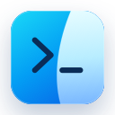
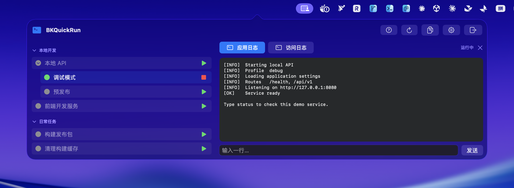

<p align="center">
  
</p>

<h1 align="center">BKQuickRun</h1>

<p align="center"><strong>从 macOS 菜单栏启动、停止和查看 Shell 脚本。</strong></p>

<p align="center">
  <code>macOS 14+</code> · <code>SwiftUI + AppKit</code> · <a href="LICENSE">MIT</a>
</p>

<p align="center">
  <a href="#项目介绍">项目介绍</a> · <a href="#界面预览">界面预览</a> · <a href="#主要功能">主要功能</a> · <a href="#开发">开发</a>
</p>

## 项目介绍

BKQuickRun 是一款原生 macOS 菜单栏工具，适合管理本地服务、构建命令和日常自动化脚本。添加现有的 `.sh` 文件后，可以给它起一个好记的名字、归入分类，再为同一个脚本保存多套启动参数。

比如，把 `start-api.sh` 收进「本地开发」，为它添加「调试模式」和「预发布」两个变体。在菜单栏点击对应变体的 ▶ 启动，点名称查看实时输出。

## 界面预览

<p align="center">
  
</p>
<p align="center"><em>在菜单栏展开 BKQuickRun，同时查看脚本变体和实时输出。</em></p>

## 主要功能

| 功能 | 说明 |
| --- | --- |
| ⚡ 快速启停 | 在菜单栏面板启动或停止脚本，直接查看运行状态。 |
| 🗂️ 分类与参数变体 | 使用别名和可折叠分类整理脚本，同一个脚本可保存多套参数，并分别运行。 |
| 🖥️ 后台与 Terminal | 脚本可以在后台运行。开启「无参数启动时显示 Terminal」后，无参数启动会打开系统 Terminal。 |
| 📋 实时日志与输入 | 在面板中查看运行输出。可为后台任务开启输入，也可以把多路日志放到不同标签页。 |
| 🔄 配置重载 | 从面板复制本地 JSON 配置路径，编辑后点击「同步配置」加载。 |

**上手只需三步**

打开菜单栏中的 BKQuickRun → 在「管理」里添加脚本 → 回到列表点击 ▶ 启动。

## 开发

项目使用 Swift、SwiftUI 和 AppKit，运行目标为 **macOS 14 或更新版本**，已用 **Xcode 26.6** 验证构建。

```bash
git clone https://github.com/binbinku/BKQuickRun.git
cd BKQuickRun
open BKQuickRun.xcodeproj
```

在 Xcode 中选择 `BKQuickRun` scheme 和 `My Mac`，按 **⌘R** 运行。改动后可在菜单栏面板验证脚本的添加、启动、停止和日志显示。

## 许可证

BKQuickRun 以 [MIT 许可证](LICENSE) 开源。
